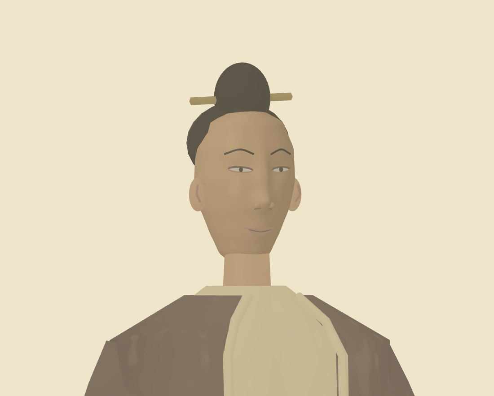
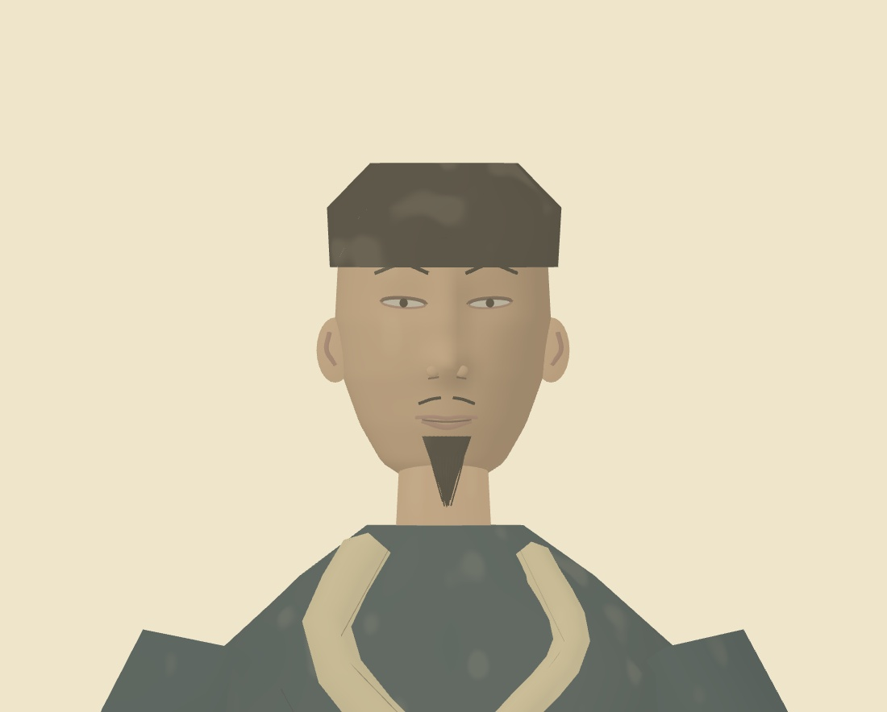
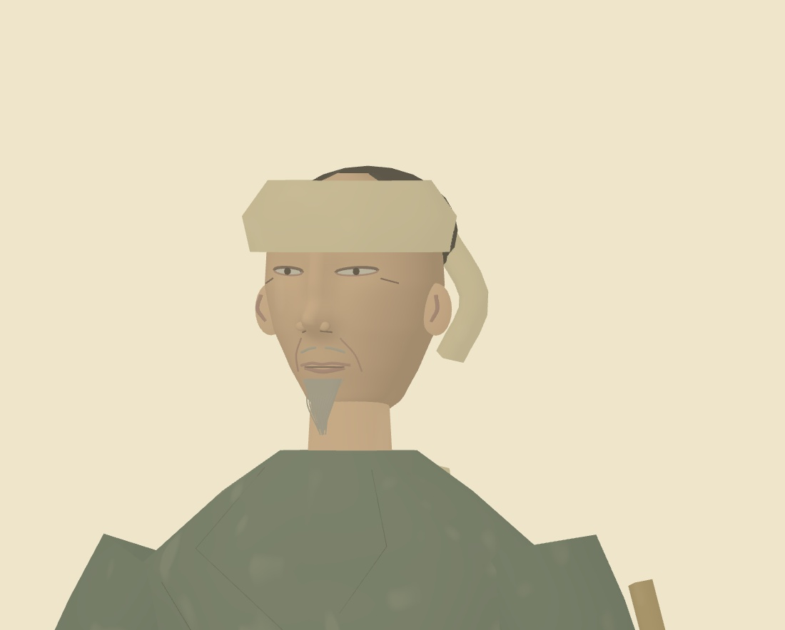
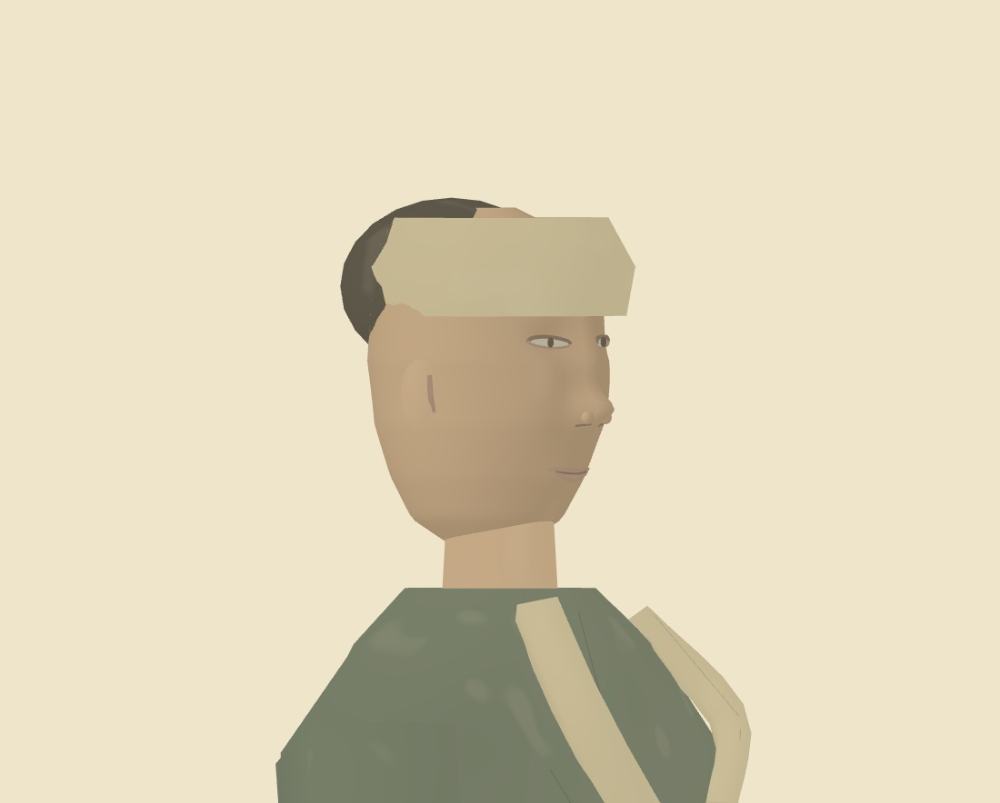

# Individual face portraits

Close-up figures now use a continuous sculpted head mesh with cheek volume, recessed eye sockets, a shaped nose bridge and tip, jaw and chin. Almond eye openings, eyelids, brows, irises, nostrils and lip curves follow the same skin surface. Ears, facial creases and a beard volume with fine strands complete the close model. A directional pigment wash makes the facial planes readable while keeping the painting palette.

Twelve role-based profiles vary head width, jaw shape, nose proportions, age and expression. The child and elder have distinct proportions. These are reusable character types, not 369 separately authored identities. The existing medium and coarse crowd budgets remain; close face geometry is selected only by the high-detail budget.

The figure study now has a **Face close-up** checkbox. Select a person and use the front/side/back controls to inspect the model. The capture API also accepts `portrait: true`.

Validation: production TypeScript/Vite build and 10 focused tests passed across face geometry, riverbank/figure compatibility and screen-space detail. Tests check finite vertices, unit outward-facing normals, matching feature and sculpt surfaces, distinct profiles and geometry reduction. Production browser capture checks shader/console/network errors, exact-time replay, high-detail faces in the main scene and a fully coarse overview crowd. See `review.json` for source hashes and settings. Four actual Three.js stills, no generated imagery or video. Software Chromium; no hardware frame-rate claim.

Reproduce after `npm run build --prefix artworks/qingming`:

```sh
node scripts/review-qingming-faces.mjs
```

The script accepts `PLAYWRIGHT_CHROMIUM_EXECUTABLE` and `PLAYWRIGHT_USE_SWIFTSHADER=1` for software-rendered capture environments.





