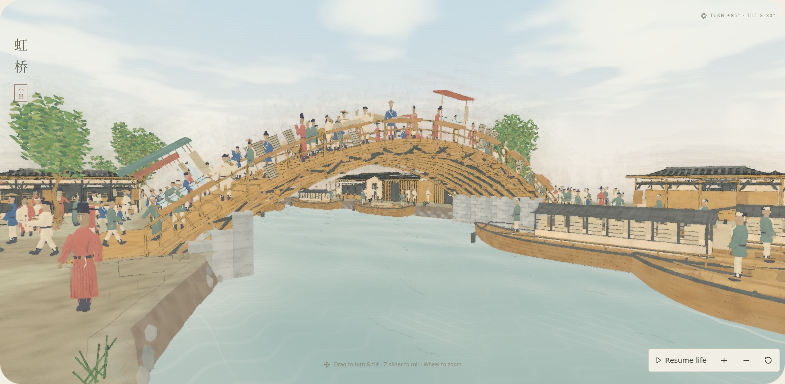
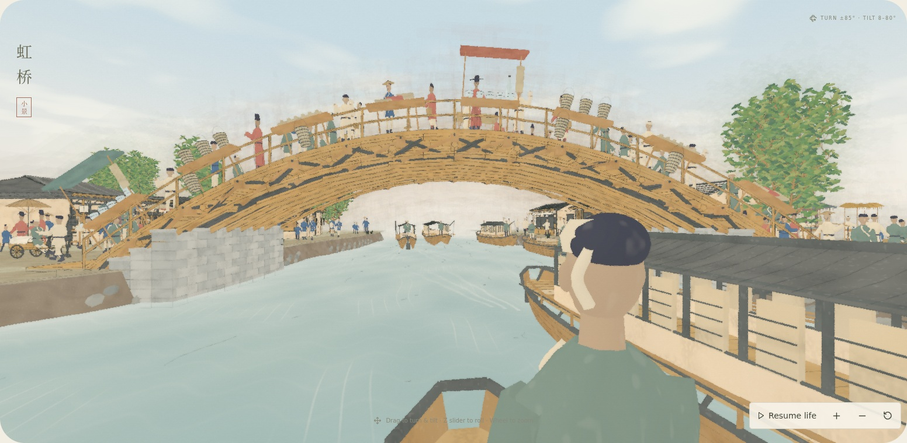
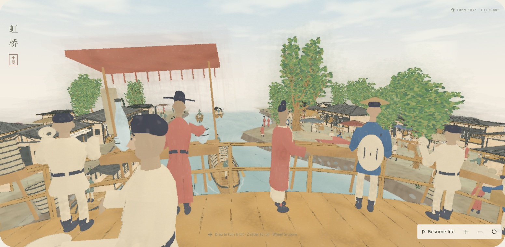
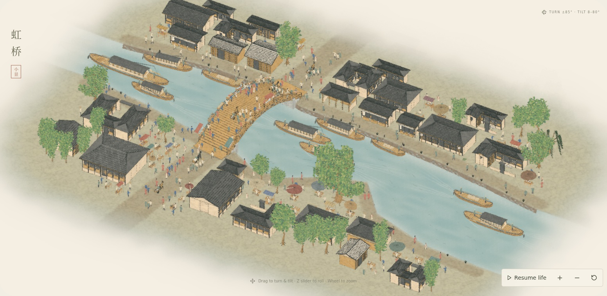
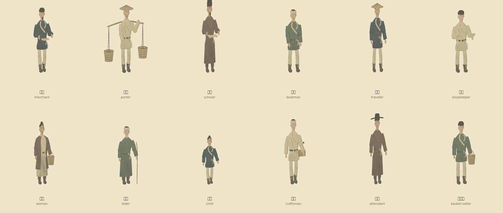

# Raised banks, masonry abutments and Song clothing

The riverbank now has roughly three feet of exposed earth and broken rocks above the animated water. Pale grey, staggered brick shoulders support the timber arch at its springings. All occupied land and bridge landings share the new height; boats remain at the water datum, with shore posts and rope ends adjusted.

People use three actual geometry budgets according to their projected screen height, with hysteresis. The complete painting uses coarse figures; low perspective views mix coarse distant figures with detailed nearby ones. Close models have smoother faces and garments, shaped facial relief, round-neck formal robes, crossed work jackets, and a separate open-front women's coat over inner layers and a skirt. A scholar's soft cap is distinct from the formal attendant's projecting headwear.

[Reference observations, museum sources and modeling decisions](../../../artworks/qingming/docs/FOUNDATIONS_AND_SONG_CLOTHING.md)

Validation:

- Production TypeScript/Vite build passed; existing chunk size advisory remains.
- Full suite: 67/68 passed initially; its sole failure was the static draw budget. Sharing the bank/brick materials resolved it without raising the budget.
- Targeted checks: 17/17 passed across riverbank/figure, passage life, landing, LOD and mooring checks (15 checks, then the four bank/figure checks rechecked alongside two mooring checks). This includes the unchanged draw-count limit, moving hulls, replay, dry routes, landing clearance and geometry detail reduction.
- Production still capture: shader/console/network errors, scene-time changes, exact replay, coarse overview and mixed perspective LOD are checked in `review.json`. Source hashes bind the stills to these model factories.
- Seven JPEG stills, no video. Software Chromium; no hardware performance claim.

Reproduction after `npm run build --prefix artworks/qingming`:

```sh
REVIEW_FOUNDATIONS=1 REVIEW_DIR=docs/reviews/2026-10-20-foundations-clothing node scripts/review-qingming-stills.mjs
```








