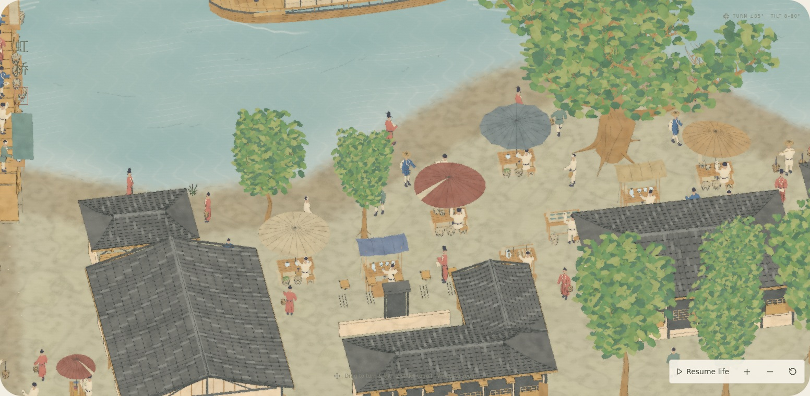
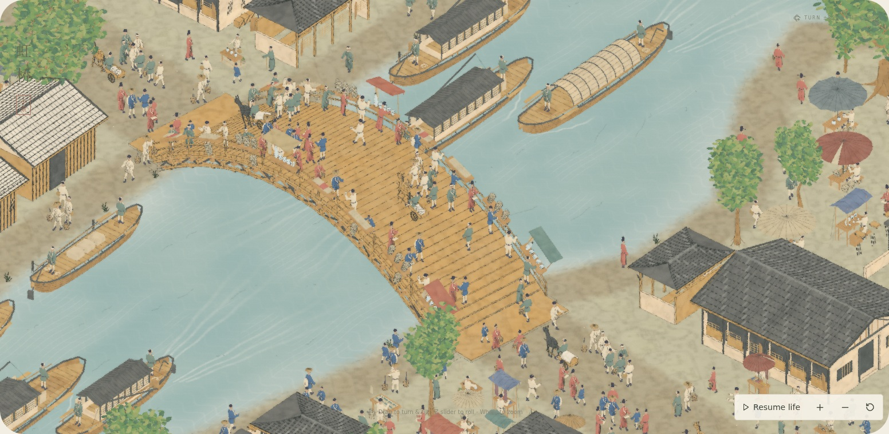
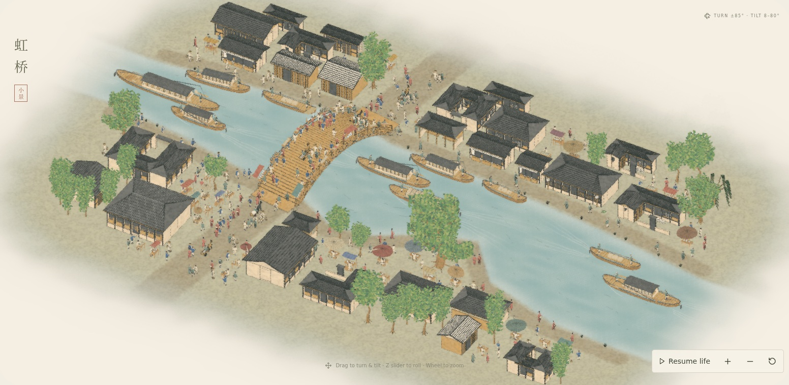

# Street-market variety and coherent human scale

The supplied [original bridge crop](../../../artworks/qingming/public/reference/rainbow-bridge.jpg) and [wider passage](../../../artworks/qingming/public/reference/selected-passage.webp) were inspected again. They show overlapping circular/oval parasols, narrow cloth shelters, low basket displays, stacked goods, and irregular shopfronts. The aged reference does not establish the original dyes: paper, ochre, brown, oxide red, sage and slate are restrained color interpretations.

## Market

- Ribbed parasols replace repeated white cones: round, oval, scalloped and patched covers, with eight shared pigment choices. Small single-vendor umbrellas also appear beside the approach streets.
- Umbrellas and rectangular awnings occupy different stalls. Woven basket and grain sellers use low trestles and mats; cloth sellers have hanging lengths and folded stock; tea/food/fish counters retain different wares. Fish use a gray-green glaze, and baskets/mats/food use cream flax rather than a shared red cloth pigment.
- Street counters sit around waist height. Canopies are raised above the tallest adult profile. All tested canopy vertices remain inside the existing reserved stall sites.

## Proportions

The previous scene mixed several scales: short, broad figures; knee-high bridge rails; tiny street counters; and some small buildings/gates with eaves below an adult's head.

The nominal adult is now **0.85 scene units** tall, about 19% taller than the preceding revision. Horizontal body scale is unchanged, retaining the existing walking clearance and giving the robes a more slender silhouette. The 3.2-unit bridge is about **3.8 adult heights** wide. The upper rail is 0.42 units, approximately waist height. Street tables are about 0.44 units high and bridge counters about 0.38 units.

Small building eaves are at least 1.12 units high; doorway headers, shop awnings, courtyard gates, gallery canopies, side-facing gable doors, and recursively built wings now clear the tallest adult profile. Additional frontage posts use the same bay layout as the doorways. Horses have taller heads/withers, and driver hips are positioned at the seat/saddle rather than placing their feet on the seat.

These are coherent model dimensions and visual interpretations, not surveyed measurements recovered from the painting's changing perspective. Roof footprints, street routes, crowd population, and the outward-only edge diffusion remain intact.

## Still review

All views use the production build, River & ochre palette, and scene time 24 seconds. No video was created.

## Validation

Production TypeScript/Vite build; full 62-test suite during the market/scale change; focused market, architecture and traffic checks during final clearance refinements (16 final market/reference/layout checks pass). The final doorway ray test checks actual geometry at the tallest adult's head height. The capture checks shader/console/network errors, deterministic replay, scene-time changes and source hashes; see [review.json](review.json). Exact command results are recorded in [checks.json](checks.json).

Screenshots use software Chromium; no hardware frame-rate claim. Reproduce after building with `REVIEW_MARKET=1 REVIEW_DIR=docs/reviews/2026-10-20-market-scale node scripts/review-qingming-stills.mjs`, optionally supplying a Chromium executable and local font mirror.
