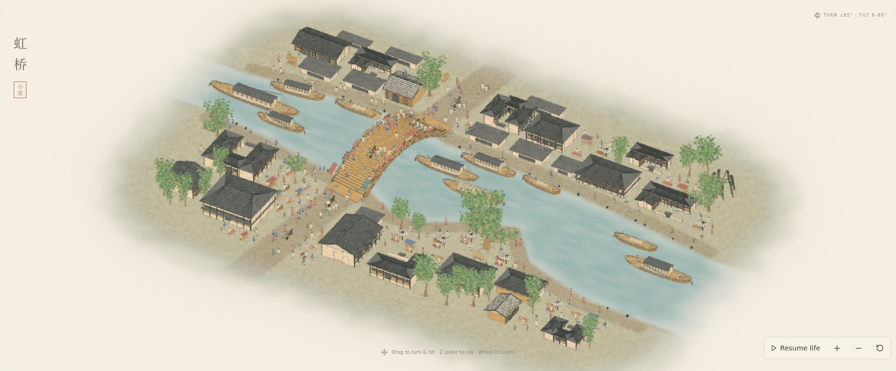
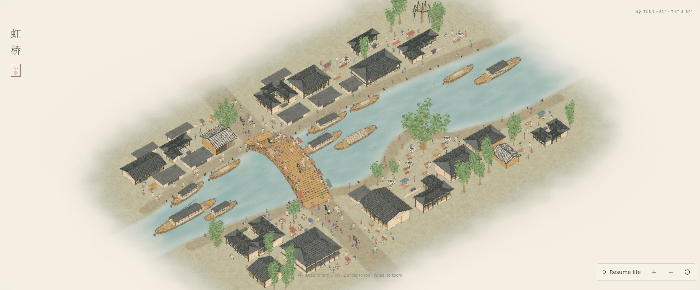

# Outward edge diffusion with intact structures

The extended wash starts outside the original scene footprint. A seven-unit exterior land/water apron gives the pigment room to diffuse into paper, with a broad, irregular fade across the new space. Inside the original boundary, the ground retains full opacity, apart from the existing soft riverbank transition.

Buildings, trees, and their ink outlines no longer receive the perimeter fading, bleaching, or dithered erasure. Their geometry, positions, colors, and foliage remain intact. The broad screen-space halo acts on translucent background wash; opaque structures retain their existing ink-and-wash treatment.

Two production screenshots in a 2048 × 1280 viewport at scene time 24 seconds use a slightly wider camera framing to show the added exterior margin. No video was created.

Validation: TypeScript/Vite production build; the landing-clearance and layout tests; production shader/console/network checks; deterministic absolute-time replay; source hashes. Exact capture results are in [review.json](review.json). Captures use software Chromium and do not establish a hardware frame rate.

Reproduce after building: `REVIEW_WIDE_EDGES=1 REVIEW_DIR=docs/reviews/2026-10-20-outward-ink-edges node scripts/review-qingming-stills.mjs`, with optional Chromium and local-font environment variables.
