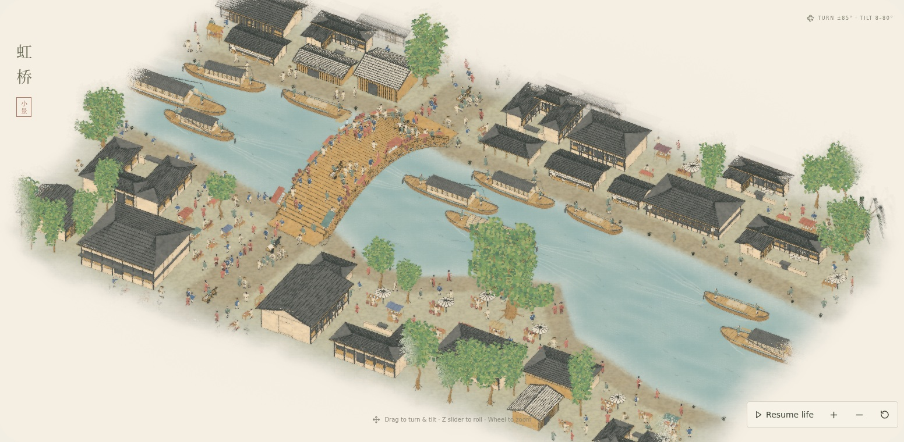
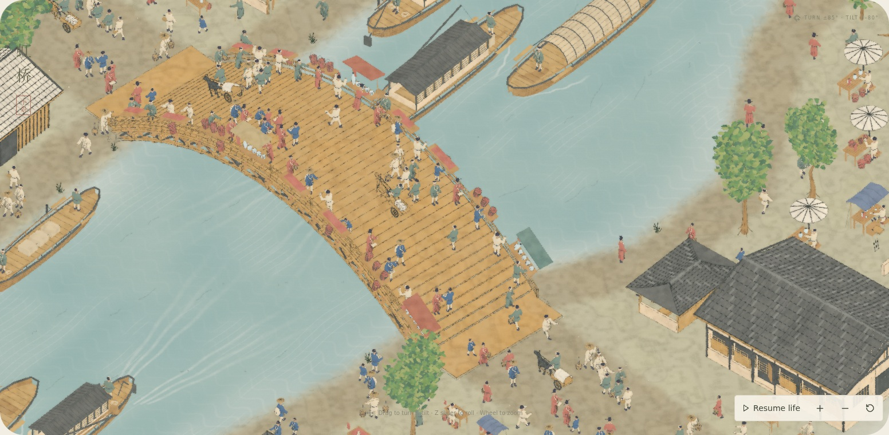
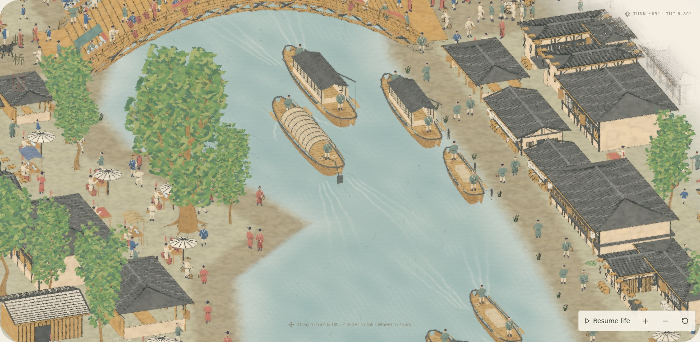

# Qingming: proportions, water, and ink diffusion

The original [Rainbow Bridge crop](../../../artworks/qingming/public/reference/rainbow-bridge.jpg) was inspected beside the model. Adult figures are now 1.05 scale instead of 0.65, about 62% taller. The nominal 0.714-unit figure gives roughly 4.5 adult heights across the bridge, with low shop eaves approximately 1.4–2 adult heights above ground. Individual adult and child profiles retain their different heights. This is a visual interpretation of the painting's variable perspective, not a measured architectural reconstruction. Bridge counters and shelters are raised to fit the revised figures.

The river has a tessellated 3D surface with three traveling wave components, view-dependent reflected light, shallow-water color, caustic glazes, and drifting fine ripples. Each moving boat has three fading stern ridges and a curved bow wave on each side. Wake heights follow the same analytic surface, preserve replay on seeking, and stay within the channel. Moored boats continue to bob without a propulsive trail.

Banks have irregular, finely sampled margins, translucent wet sediment, broken ink contours, and a softer overlap with the water. The perimeter wash has a wider gradient and irregular pigment absorption; silhouettes and ink also dissolve into the paper. A broad outer diffusion pass leaves interior figures and architectural linework legible. Trees have denser overlapping leaf sprays, mixed greens, and subtle leaf movement; willows have fuller hanging strands.

Camera yaw is now ±85°, elevation is 8–80° above the river, and roll is ±45°. The reset composition remains at the familiar +30° yaw. The presets show ±75° views.

## Still review

Three production stage screenshots captured in a 1600 × 1000 desktop viewport, all at scene time 24 seconds in the River & ochre palette. No video was created for this revision.

## Validation

- Production TypeScript/Vite build.
- 59 unit tests pass: traffic, proportion bounds, water-conforming wakes, deterministic replay, shared geometry, animation freeze, and distance-based detail.
- All 8 desktop/mobile browser checks pass: widened controls, drag bounds, reset, rendering controls, and reference navigation. One mobile cold load exceeded the development-server startup deadline in the full run; a fresh targeted retry passed in 26.9 seconds without changes.
- Production still capture: shader, console, and network errors; repeatable absolute-time rendering; different scene times produce different images. Exact results and source hashes are in [review.json](review.json).

Screenshots use software Chromium and are visual evidence, not a hardware frame-rate benchmark. Reproduce with `node scripts/review-qingming-stills.mjs` after building the Qingming app; optional environment variables select a Chromium executable and a local font mirror.
