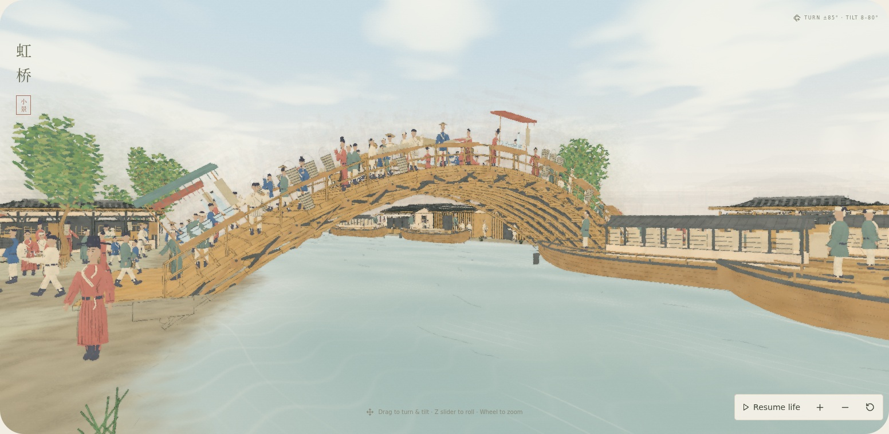
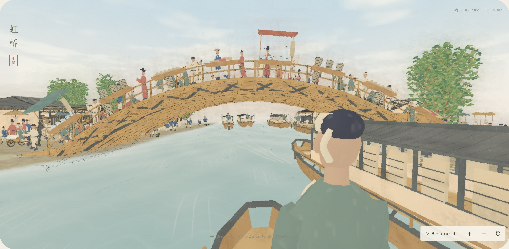
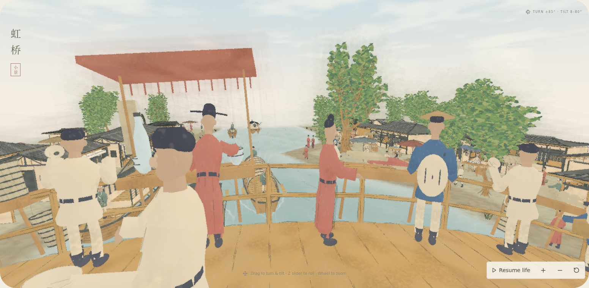

# Riverside perspectives

Three production-rendered stills at scene time 24 seconds, using the River & ochre palette. No video.

- **Bank:** human-height camera at scroll `(0, 4.2)`, eye height 1.05, looking toward Rainbow Bridge.
- **Boat:** camera aboard moving vessel 3, at 28% of its nominal length toward the bow, a quarter-width to one side, and 1.12 units above its origin. The camera follows the same position, bob, pitch and roll as the actual vessel; the bridge remains ahead.
- **Bridge:** camera at the arch crown, eye height 2.9, looking downriver across the handrail.

These use true perspective projection (60–62 degree vertical field of view). The usual orbit view remains orthographic. Capture API `eye` and `look` coordinates are `[scroll position, height, depth]`; `aboard` attaches the eye to a vessel instead. Pale blue sky and layered procedural cloud washes are composited behind scene coverage only for perspective cameras. World-direction cloud coordinates keep the sky stable as the camera turns. Existing paper backgrounds and outward edge diffusion remain in overview views.

Validation: production TypeScript/Vite build and the browser results in `review.json`. The capture checks console/shader/network errors, exact-time replay for both boat-attached and overview cameras, changing scene time, and source hashes. Images were inspected in software Chromium; no hardware performance claim.

Reproduce after `npm run build --prefix artworks/qingming`:

```sh
REVIEW_PLACES=1 REVIEW_DIR=docs/reviews/2026-10-20-riverside-views node scripts/review-qingming-stills.mjs
```

Optional capture environment variables for software Chromium and mirrored fonts are documented in the script.




