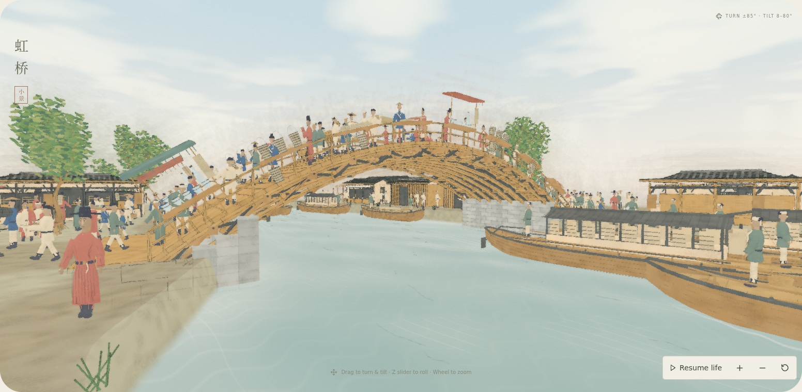
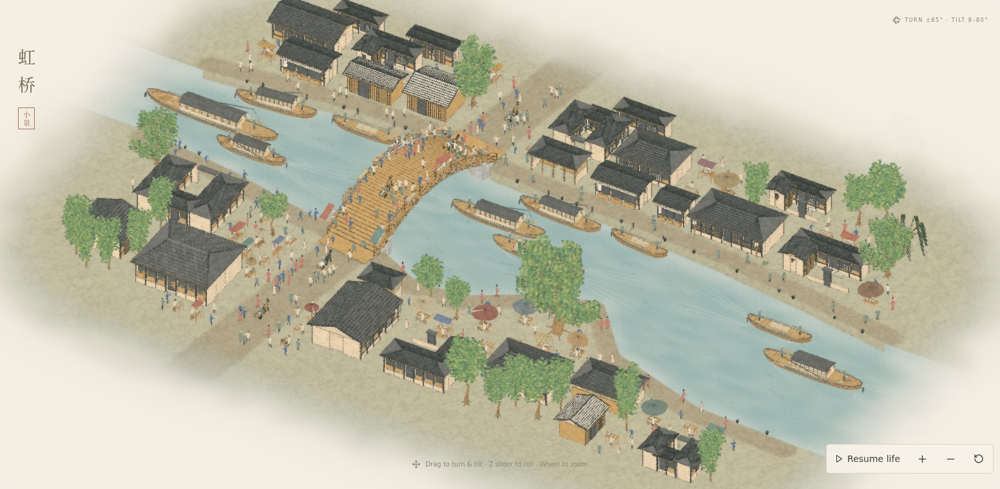

# Softer riverbanks

Directly inspected the bundled original `artworks/qingming/public/reference/rainbow-bridge.jpg`. Its bank reads as a continuous earth mass with rounded turns, restrained contour strokes and occasional stones. The previous render's dark planar face and large pale polygon stones made it read as a cut retaining wall.

This revision rounds the shoreline polyline with an exact local box convolution, giving continuous tangents at bends. A 17-row curved cross-section eases into the lip and submerged toe. The upper land boundary and its faint contour use the same geometry, eliminating an overhanging flat rim. The earth wash matches the upper ground, with a faint damp gradient and alpha diffusion at the waterline. Smaller, rounded, earth-colored stones occur sparsely instead of forming a white spotted pattern. The elevated ground datum, water level and brick bridge abutments are retained.

Validation: production TypeScript/Vite build and six focused tests passed, including bend tangents, eased lip, bank toe clearance, raised ground and bridge landing clearance. `review.json` records the production browser capture, shader/console/network errors, exact-time replay, scene-time changes and source hashes. Two stills, no video. Software Chromium; no hardware performance claim.

Reproduce after building:

```sh
REVIEW_SMOOTH_BANKS=1 REVIEW_DIR=docs/reviews/2026-10-20-soft-banks node scripts/review-qingming-stills.mjs
```



