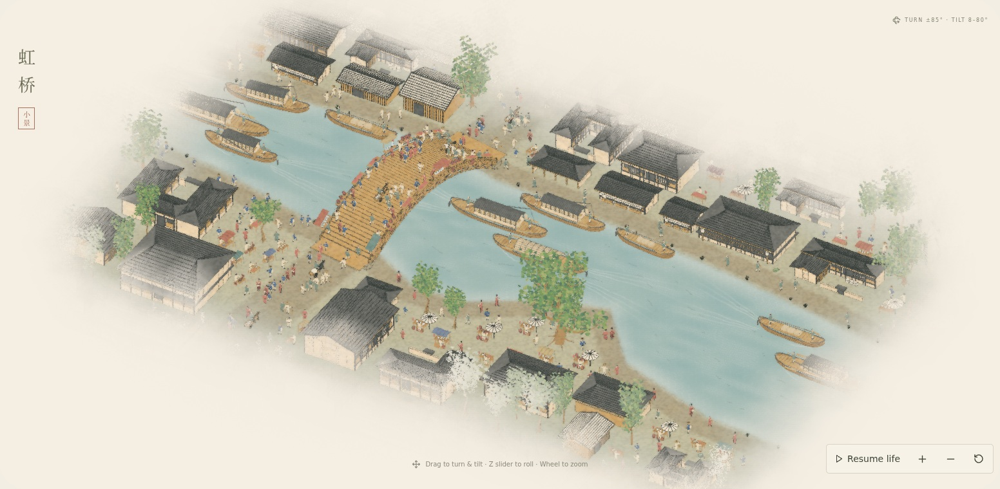
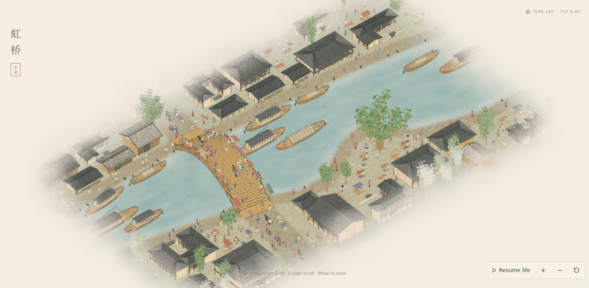

# Wider picture-edge diffusion

The outer land and water wash now fades across about 70% more scene space. Figures, buildings, and ink silhouettes dissolve through a matching band about 80% wider than before. Larger, slower pigment variations soften the edge shape. Border colors lighten continuously and ink lines fade faster, softening the disappearing silhouettes. The capillary diffusion pass samples out to roughly three times the previous radius, extending a faint wash into the surrounding paper.

Two wider compositions show the edge treatment from +30° and −40° yaw. Screenshots are from the production build at scene time 24 seconds. No video was created.

Validation: the TypeScript/Vite production build passes. The production capture checks shader/console/network errors, absolute-time replay, scene-time changes, and source hashes; exact results are in [review.json](review.json). The preceding proportion/water revision's full behavioral test results remain documented in [its review](../2026-10-20-proportions-water/README.md). Software Chromium was used for still capture, without a hardware frame-rate claim.

Reproduce after building: `REVIEW_WIDE_EDGES=1 REVIEW_DIR=docs/reviews/2026-10-20-wider-ink-edges node scripts/review-qingming-stills.mjs`. The capture script also accepts an optional Chromium executable and local font mirror.
