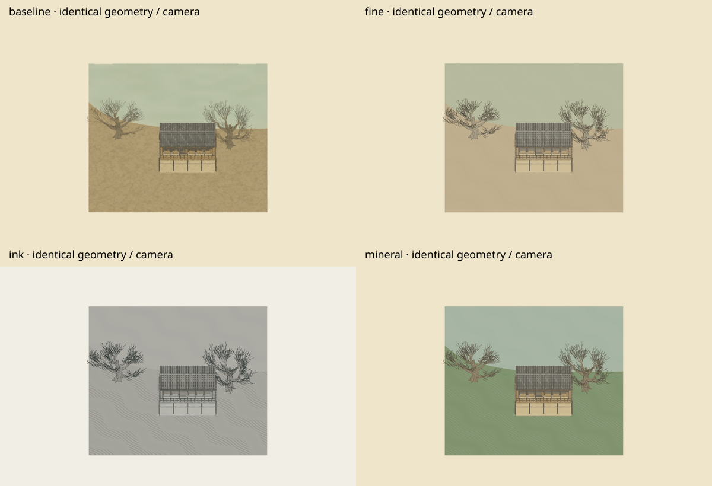
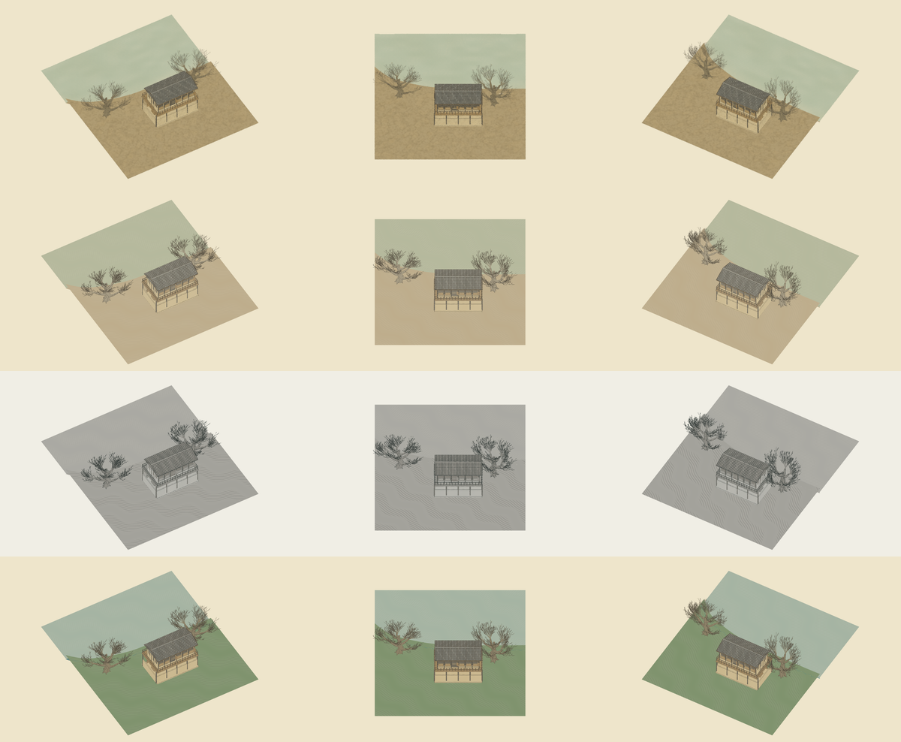

# Controlled Chinese painting style lab

An isolated comparison of baseline, fine-line, expressive ink and blue-green-inspired treatments on the same building/tree/shoreline subset. These are diagnostic prototypes, not accepted faithful reconstructions.

- [Report, source assessment, measurements and limits](REPORT.md)
- [Reusable workflow draft](WORKFLOW.md)
- [Machine-readable measurements](measurements.json)
- [Reference evidence and hashes](reference-evidence.json)
- [Fine-line still](fine-0.png), [baseline](baseline-0.png), [expressive ink](ink-0.png), [blue-green-inspired](mineral-0.png)
- [Ink surface marks disabled: controlled ablation](ink-marks-off.png)
- [Short ink orbit](ink-orbit.mp4)
- [Qingming reference pixels](qingming-reference-pixels.png), [blue-green reference pixels](blue-green-reference-pixels.png)

From the repository root, use the project's documented dependency setup, then run `npm run dev --prefix artworks/qingming` and open `/style-lab.html`. The normal `npm run build` includes this entry. Capture with `node scripts/review-style-lab.mjs`; the script expects `/usr/bin/chromium`. Generate the reference crops with `node scripts/style-lab-reference.mjs`.

Saved validation: build passed and all 82 existing tests passed. All four styles returned to identical starting pixels after orbit; selected intermediate frames were visually inspected. Full motion, target-device performance, fitted reference registration and LOD transitions remain unvalidated. See the report for precise scope and performance measurement caveats.

Publication scope: completed source, scripts, workflow/report, validation logs and selected image/video evidence are saved on the isolated style-lab branch. Redundant repeat frames, raw motion frames, capture/transfer diagnostic logs, local dependency symlinks and packaged transfer copies are intentionally excluded. The capture scripts can regenerate the omitted frames. Original baseline modeling files are unchanged.
